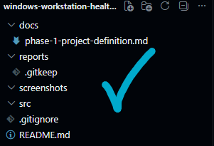
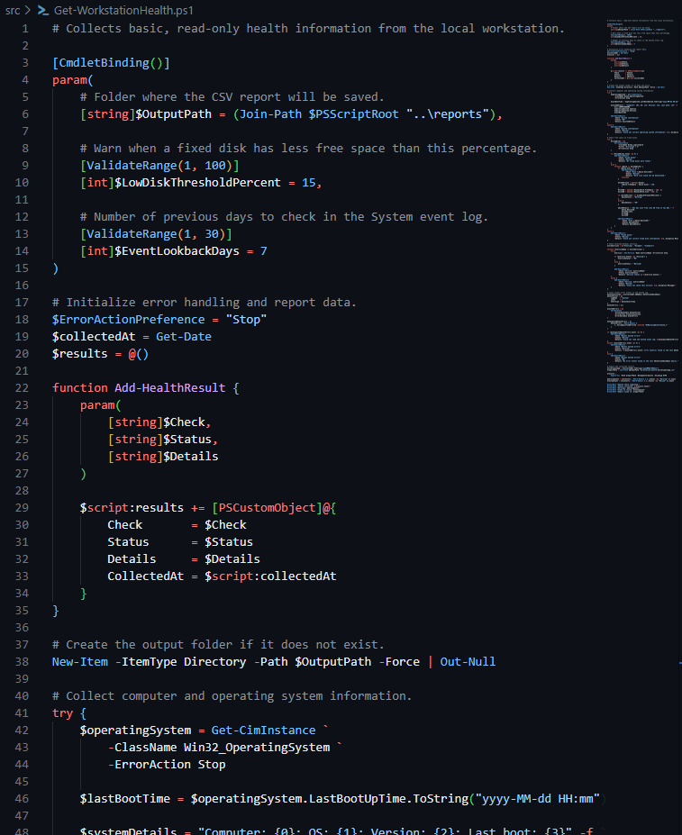
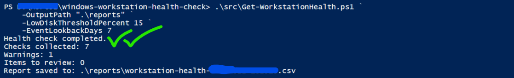
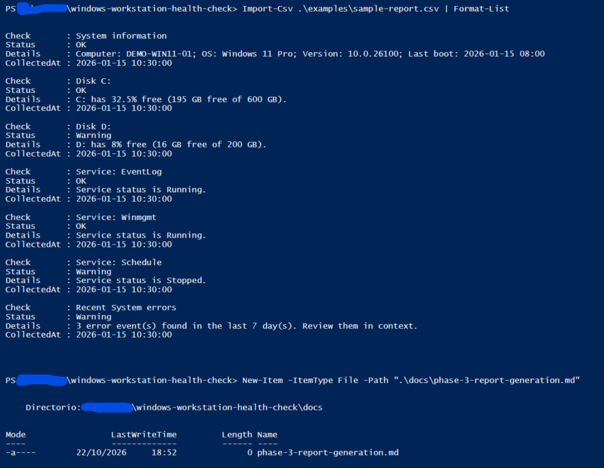

# Windows Workstation Health Check

A read-only PowerShell project that collects basic health indicators from a Windows 11 workstation and prepares a CSV report.

## Scenario

A junior system administrator needs a repeatable snapshot of a workstation before investigating a reported performance issue.

## Project Goals

- Practice basic PowerShell scripting.
- Collect useful local system information.
- Present findings in a clear report.
- Document the process for other administrators.

## Safety

The script will read system information only. It will not change system settings or attempt repairs.

Reports generated from a real computer will not be published because they may contain identifying system information.

## Sample Report

[View the fictional sample CSV](examples/sample-report.csv).

> **Privacy note:** This is a fictional sample report created for demonstration purposes. It contains no data from a real computer. Actual reports may include identifying system information and are not published for privacy reasons.

## Project Status

Phase 1: project definition.
Phase 2: initial script implemented.

## Documentation

- [Phase 1: Project Definition](docs/phase-1-project-definition.md)
- [Phase 1: Script Implementation](/docs/phase-2-script-implementation.md)

## Phase 1 Screenshot

## Phase 2 Screenshots

### Script

### Run summary

## Phase 3 Screenshots

### Sample report

