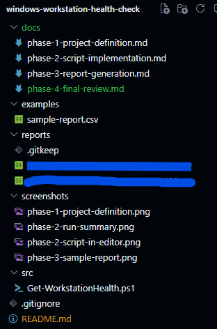

# Windows Workstation Health Check

A read-only PowerShell project that collects basic health indicators from a Windows 11 workstation and prepares a CSV report.

## Scenario

A junior system administrator needs a repeatable snapshot of a workstation before investigating a reported performance issue.

## Project Goals

- Practice basic PowerShell scripting.
- Collect useful local system information.
- Present findings in a clear report.
- Document the process for other administrators.

## Requirements

- Windows 11.
- Windows PowerShell 5.1 or a compatible PowerShell session.
- No external modules are required.

## Usage

Run the script from the repository folder:

    .\src\Get-WorkstationHealth.ps1

Optional parameters:

    .\src\Get-WorkstationHealth.ps1 -OutputPath ".\reports" -LowDiskThresholdPercent 15 -EventLookbackDays 7

## Parameters

| Parameter | Default | Purpose |
|---|---:|---|
| `OutputPath` | `reports` | Folder where the CSV report is saved. |
| `LowDiskThresholdPercent` | `15` | Free-space percentage below which a disk is marked as a warning. |
| `EventLookbackDays` | `7` | Number of previous days checked in the System event log. |

## Report

The script creates a timestamped CSV file with the columns `Check`, `Status`, `Details`, and `CollectedAt`.

- `OK`: the check completed without meeting a warning condition.
- `Warning`: the check found an indicator that may need investigation.
- `Review`: the script could not collect the information.

Warnings are indicators, not diagnoses. Event-log entries should be interpreted in context.

## Fictional Sample Report

[View the fictional sample CSV](examples/sample-report.csv).

> **Privacy note:** This is a fictional sample report created for demonstration purposes. It contains no data from a real computer. Actual reports may include identifying system information and are not published for privacy reasons.

## Screenshots

### Initial project definition

### Script in editor

### Run summary

### GitHub repository

## Safety and Privacy

The script reads local system information and does not change settings or services. Reports generated from a real computer are excluded from version control because they may contain identifying information. Screenshots must also be reviewed before publication.

## Limitations

- The script checks the local computer only.
- It does not repair problems or perform a full security audit.
- A warning does not prove that a fault exists.
- Service status and event-log entries may need interpretation for the specific computer.

## Project Documentation

- [Phase 1: Project Definition](docs/phase-1-project-definition.md)
- [Phase 2: Script Implementation](docs/phase-2-script-implementation.md)
- [Phase 3: Report Generation](docs/phase-3-report-generation.md)
- [Phase 4: Final Review](docs/phase-4-final-review.md)

## What I Learned

- How to use PowerShell parameters, variables, functions, and error handling.
- How to collect local Windows information with built-in commands.
- How to export structured data to CSV.
- How to document and publish a small system-administration project.

